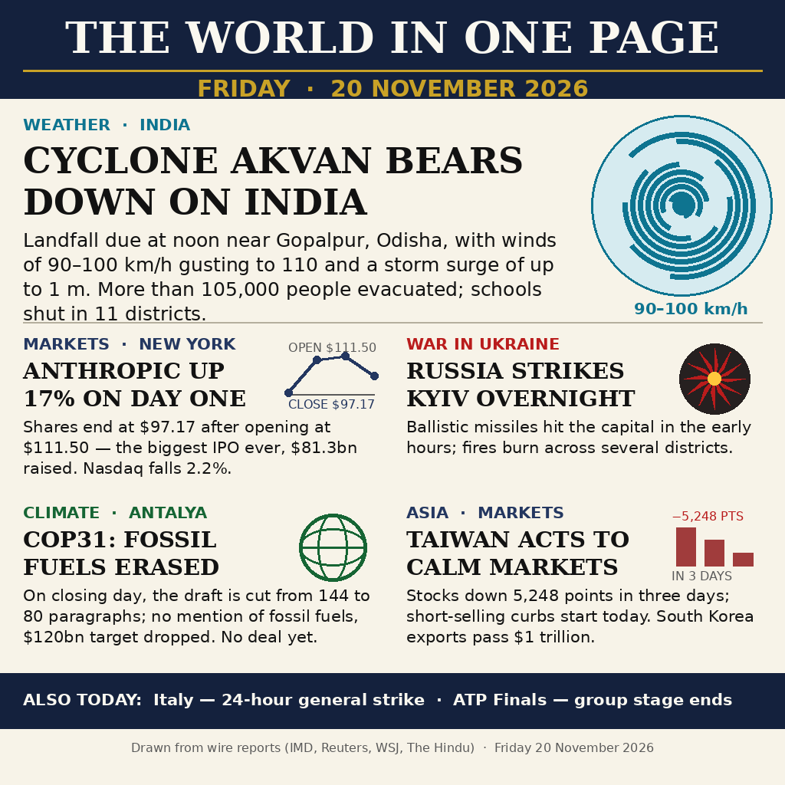

# The World in One Page — Friday 20 November 2026

[](https://make.fun/bounty/news-image-20261120)
[](https://make.fun/bounty/news-image-20261120)
[](https://make.fun/bounty/news-image-20261120)

An entry for the [make.fun bounty "Sum up 20 November's world news in
one image"](https://make.fun/bounty/news-image-20261120): a program that
writes one image summing up the world's news of Friday 20 November
2026 to `/output/entry.png`.

## The image

A newspaper front page, drawn programmatically (PIL, no AI-generated
imagery), covering the day's verified stories:

- **Cyclone Akvan** bears down on India's east coast — landfall due at
  noon near Gopalpur, Odisha; 105,000+ evacuated
- **Anthropic (ANT)** closes its first trading day up 17% at $97.17,
  the biggest IPO ever; Nasdaq falls 2.2%
- **Russia strikes Kyiv overnight** with ballistic missiles; fires
  across several districts
- **COP31 closing day** in Antalya — the draft drops all fossil-fuel
  wording and the $120bn target; no deal yet
- **Taiwan acts to calm its markets** after a 5,248-point slide in
  three days; South Korea's exports pass $1 trillion
- Also: Italy's 24-hour general strike, and the ATP Finals group
  stage ending in Turin



## How it works

`main.py` (Python 3.13, standard library only) copies the pre-rendered
`entry.png` to the output directory. It runs with no network and writes
the same bytes on every run:

```sh
mkdir -p out && MAKEFUN_OUTPUT_DIR=out python3 main.py
```

The image is 1024×1024 PNG, under 1 MiB.

## License

MIT — see [LICENSE](LICENSE).
